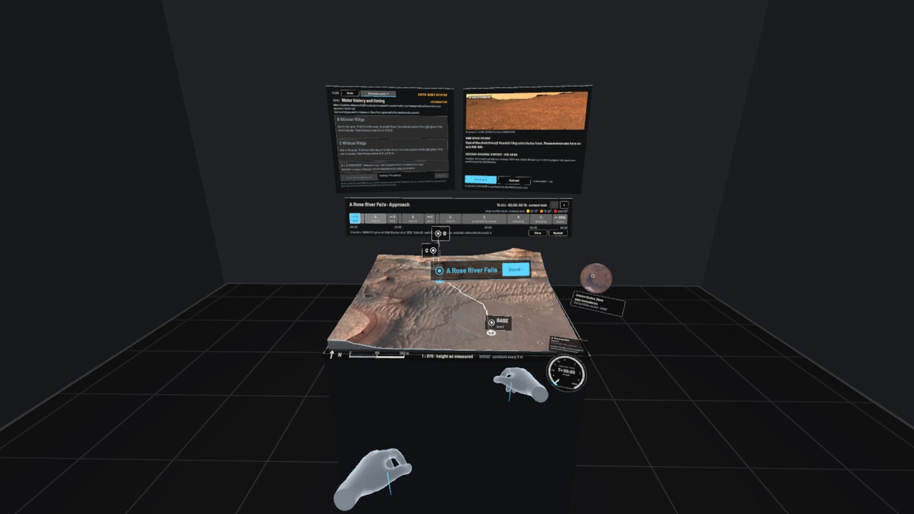
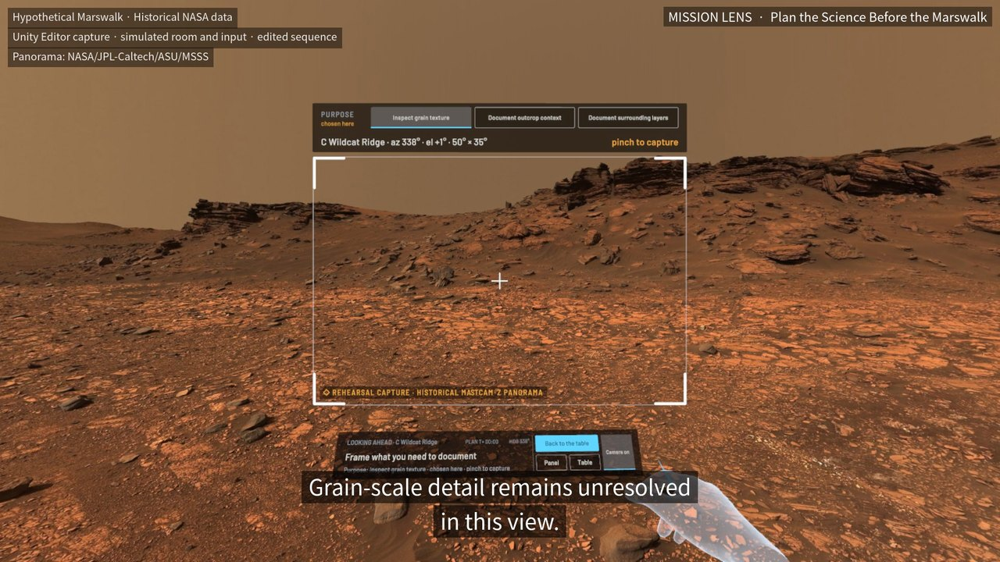

# Mission Lens — Plan the Science Before the Marswalk

NASA Space Apps Challenge 2026 · *Interplanetary Survival Guide: Martian Map* · Tokyo

**Mission Lens turns science objectives into a visual observation plan before a hypothetical Marswalk.** In an Earth-based briefing, a crew scientist moves between a tabletop terrain map and Perseverance's panoramas, frames a view, chooses its purpose and plans the next observation. The saved briefing records **where to look, why, and what remains unresolved**.

Built in Unity for Meta Quest 3, with hand or controller input and a desktop mode in the Unity Editor.

**[Watch the 30-second demo](https://github.com/Ando-O7/MissionLens/releases/download/submission-2026-11-15/MissionLens_demo_30s.mp4)** · [Read a saved plan](docs/examples/observation_plan/README.md) · [Try the app](#run-it)

The demo is 29.23 seconds (44 MB): an edited Unity Editor recording with scripted input. [Recording and editing details](docs/DEMONSTRATION.md).

## One saved observation

At **Wildcat Ridge**, the user wants to inspect grain texture. The panorama leaves close-up detail and size unresolved, so the user plans a **close-up with scale**. That purpose, next action and open question remain linked to the framed image in the saved plan.

*This excerpt is drawn from the JSON saved during the demo recording; it is not an app screen. The image is a view framed in historical NASA imagery. The close-up is planned, not yet collected.*

[Read the complete example](docs/examples/observation_plan/README.md), including Skinner Ridge and the planned documentation of the outcrops' geological relationship. The example includes the actual saved JSON and both images; no headset is needed to inspect it.

## What you do

1. **PLAN:** review the science objective, terrain, published rover interpretation and sampling records. Choose the role each outcrop serves in your plan.
2. **FIELD:** look around its Mastcam-Z panorama, frame a view and attach an observation purpose. Choose a follow-up observation such as a close-up with scale.
3. **PLAN:** review the photos and planned observations together, include the geological relationship, and save the briefing with its evidence and unresolved questions.

| PLAN | FIELD |
|---|---|
|  |  |

A briefing may make an existing plan more specific; changing the plan is not required. [Controls and detailed walkthrough](docs/USER_GUIDE.md).

## Why XR, and what comes next

Mission Lens uses XR to connect map-based planning with the physical actions of looking around, pointing, and framing a view. The aim is embodied preparation: rehearsing where to look and what to document before an excursion. Future evaluations will compare spatial understanding and recall with a desktop interface using the same data. Longer term, we aim to bring the same links between location, view and scientific purpose into helmet-mounted AR support, carrying briefing context into fieldwork.

## Why these two outcrops?

The science question is: **what should we observe to connect an ancient water environment with evidence that could constrain its timing?**

Published rover science gives the two sampled outcrops complementary value:

| Outcrop | Scientific motivation | Planned work in the saved example |
|---|---|---|
| **Wildcat Ridge** | Its fine-grained sediments provide a record of an ancient water environment. | Inspect grain texture; plan a close-up with scale. |
| **Skinner Ridge** | Its coarser grains offer material relevant to investigating timing, with geological context and laboratory analysis. | Document outcrop context; plan a wider context image. |
| **Both together** | Their geological relationship must be documented to connect the evidence. | Plan documentation of that relationship. |

These motivations come from [Bosak et al. (2024)](https://agupubs.onlinelibrary.wiley.com/doi/full/10.1029/2024AV001241), not from image analysis by the app. The plan establishes no age or new geological finding. [Scientific references](docs/DATA_SOURCES.md#other-references).

## NASA data

| Evidence | Its role in the briefing |
|---|---|
| HiRISE-derived terrain and orbital imagery | Tabletop terrain, slopes, route context and modeled visibility |
| Mastcam-Z panoramas and WATSON close-ups | Ground views to frame and existing rover detail to consult |
| Mars 2020 sample and location records | Sampling history and station context |
| CRISM browse imagery | Regional spectral context; not a ranking of these outcrops |

[All NASA sources, credits and processing](docs/DATA_SOURCES.md#nasa-data) are documented, including the other datasets used by the app and earlier prototypes.

The app distinguishes **existing evidence**, **rehearsal captures** framed from that evidence, and **planned observations** still to be collected. Purposes and next observations are the user's choices. It infers no age, mineral or grain size from a photo.

## What has been checked

| Check | Current evidence |
|---|---|
| **Planning workflow in the Unity Editor** | Automated checks cover purpose selection, photo-linked observations, save failures and successful saves, and restart persistence. [Detailed coverage](docs/TECHNICAL_REFERENCE.md#what-has-been-checked). |
| **Terrain, visibility and source records** | An independent read of the public terrain window matched the cache. All 12 directed station visibility flags were reproduced; panorama registration and NASA sample records were checked. [Results, figures and procedures](docs/validation/README.md). |
| **Saved outcome** | The demo's [plan and photos](docs/examples/observation_plan/README.md) are available for inspection. |

**Still untested:** the new observation-plan and camera features on Quest hardware, and whether users or briefing recipients understand or make better decisions with the plan. Earlier builds ran on Quest 3; the new workflow has been checked in the Editor. No human evaluation has been conducted.

## Limits

This is an Earth-based briefing prototype using historical observations from different sols. A panorama has no depth; its map alignment is approximate. Modeled visibility concerns specified station target points, not whole outcrops. Neither the terrain display nor a saved plan establishes safe traversability or operational suitability on Mars. [Model assumptions, known errors and evaluation scope](docs/TECHNICAL_REFERENCE.md#limits).

## Run it

- **Meta Quest 3:** [Download the APK](https://github.com/Ando-O7/MissionLens/releases/download/submission-2026-11-15/MissionLens_Quest3.apk) (96 MB). [Installation and controls](docs/USER_GUIDE.md#run-it).
- **Desktop:** open `unity/` in Unity 6000.3.6f1. [Setup and walkthrough](docs/USER_GUIDE.md#run-it). No standalone desktop build is supplied.
- **Inspect or reproduce:** [saved-plan fields and data build commands](docs/TECHNICAL_REFERENCE.md) · [source code](unity/Assets/MissionLens/Runtime/) · [data tools](tools/).

## Use of AI

The developer directed and reviewed AI-assisted work: Claude Code for application code and documentation; ChatGPT and Codex for concept planning, evidence checks and submission drafts. The demo uses scripted input. No image, video or voice was made by a generative model; Mars imagery comes from mission data and geometric reprojection. [Full disclosure](docs/DATA_SOURCES.md#use-of-ai).

## License

Original code and authored documentation are under [MIT](LICENSE). NASA imagery, Unity/Meta components, fonts and other third-party materials retain their own terms; the APK as a whole is not MIT-licensed. [Sources and licensing scope](docs/DATA_SOURCES.md#license) · [Third-party notices](THIRD_PARTY_NOTICES.md). The notices identify open issues concerning Unity hand-model source distribution and the EmojiOne sample. Use of NASA data does not imply NASA endorsement.
