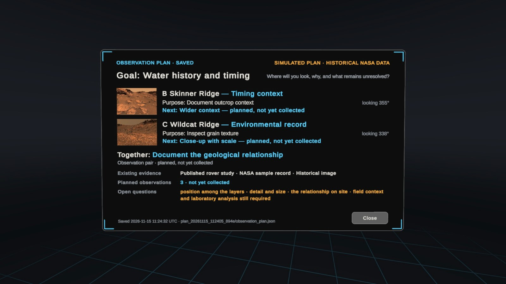
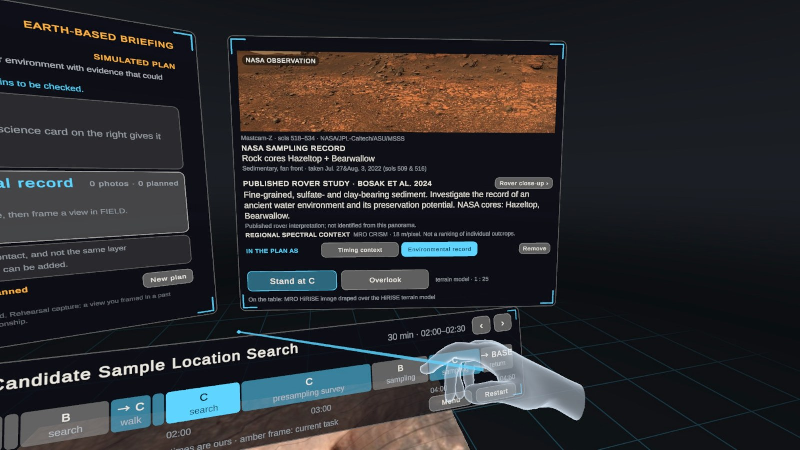
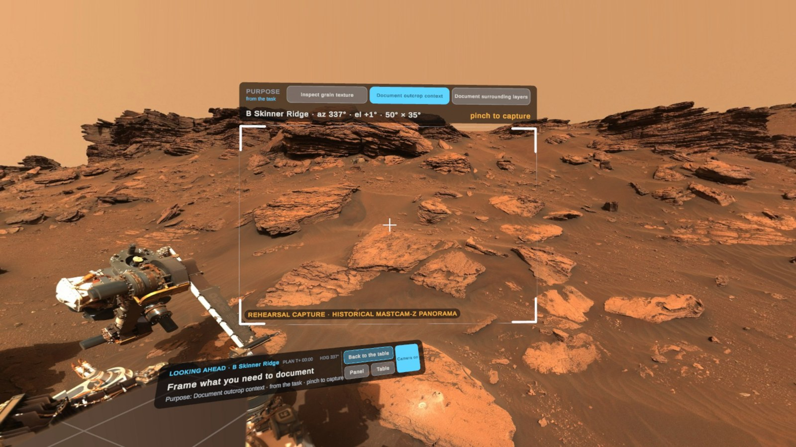
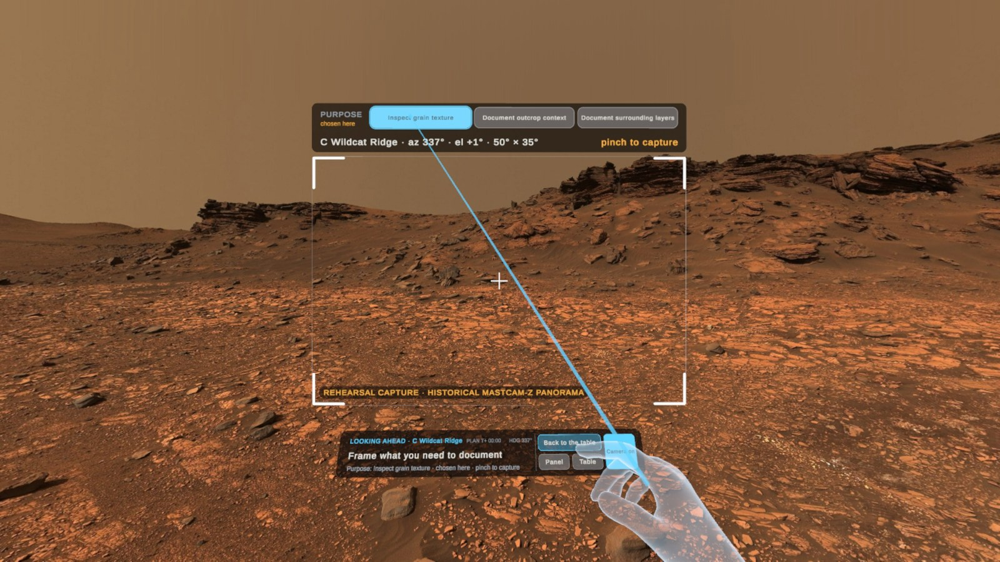

# Mission Lens — Plan the Science Before the Marswalk

NASA Space Apps Challenge 2026 · *Interplanetary Survival Guide: Martian Map* · Tokyo

**Mission Lens turns science objectives into a visual observation plan before a hypothetical Marswalk.** Using NASA data from Skinner Ridge and Wildcat Ridge, two outcrops Perseverance sampled at the front of Jezero Crater's fan, users connect an ancient water environment with evidence relevant to its timing. They move between a tabletop terrain map and Perseverance's panoramas, frame views, and link each image to its purpose and to the follow-up observations they plan. The saved briefing records where to look, why it matters, and what remains unresolved. Historical NASA evidence, our calculations and planned observations remain distinct.

Built in Unity for Meta Quest 3 (hands or controllers). The same app runs on a desktop in the Unity Editor.

| | |
|---|---|
| Demonstration, 30 seconds | [MissionLens_demo_30s.mp4](https://github.com/Ando-O7/MissionLens/releases/download/submission-2026-11-15/MissionLens_demo_30s.mp4) (29.3 s, 55 MB; how it was made is [below](#how-the-demonstration-film-was-made)) |
| App for Meta Quest 3 | [MissionLens_Quest3.apk](https://github.com/Ando-O7/MissionLens/releases/download/submission-2026-11-15/MissionLens_Quest3.apk) (96 MB; see [Run it](#run-it)) |
| A saved plan, as the app writes it | [docs/examples/observation_plan/](docs/examples/observation_plan/) — a simulated example |
| What was checked, and how | [What has been checked](#what-has-been-checked) · [docs/validation/](docs/validation/README.md) |
| Sources and credits | [NASA data](#nasa-data) · [Other references](#other-references) |
| What this does not show | [Limits](#limits) |



## The briefing task

A crew scientist needs an observation plan that connects the record of an ancient water environment with evidence that could constrain its timing. Published rover science explains why the fine-grained sediments of Wildcat Ridge and the coarser grains of Skinner Ridge are of complementary value. What should the crew document at each outcrop, and how should it keep their geological context?

The app asks one question and keeps to it:

> What should we observe at both outcrops to connect an ancient water environment with evidence that could constrain its timing?

The briefing turns a science goal into what to look at on the ground and what to record. It can make an existing plan more specific without changing it: someone who already meant to take a context image and a close-up leaves with the framing, the place, the purpose and the open question of each. A change of plan is not required, and nothing in the app scores one.

## What you do

1. **PLAN — the goal and the two outcrops.** The briefing opens on the observation plan, which is empty. At the table, choose a task at an outcrop (or pick the outcrop on the map). The panel on the right shows NASA's sampling record and a short science card from the published rover study. Give the outcrop the role it serves in the plan: *Timing context* or *Environmental record*. Either role can be given to either outcrop; the app does not hold a right answer.
2. **FIELD — frame a view.** Stand at the outcrop, inside the Mastcam-Z panorama taken there, and open the camera. A frame follows your head. The view takes its purpose from the task you selected (*Document outcrop context*, *Inspect grain texture*, *Document surrounding layers*); if that task carries none, you choose one once, under the frame. Pinch, pull the trigger or click to capture.
3. **Choose the next observation.** The photo's card offers three buttons: *Plan close-up with scale*, *Plan wider context*, *Plan another viewpoint*. Each adds an observation that is still to be made, tied to that photo. None is required, the same one cannot be added twice, and *Review later* only sets the photo aside.
4. **PLAN — both outcrops side by side.** Back at the table the outcrop you stood at is still selected and the photo you just took is open on the right, where its purpose and next observations can be changed or taken back. The plan has one row per outcrop: its role, how many photos and planned observations, and for the photo shown, its purpose, what was planned from it and what that leaves to verify. Picking an outcrop brings up its record; *Compare photos* puts the two outcrops' photos side by side. On the map only the photo that is picked shows as a sector from where it was taken (both, while comparing), and you can return to the panorama facing the same way. However many photos there are, the plan stays three rows.
5. **Add the relationship and save.** *Document the geological relationship* is an item of its own; the line it draws between the outcrops is labelled *Observation pair*, not a contact or a shared layer. *Save observation plan* writes the plan and its images, and says it is saved only after reading the file back.

| | | |
|---|---|---|
|  |  |  |
| Science card and role | A view framed in the panorama | The next observation, from the photo |

The rest of the app, built for the Tokyo venue, is the panel's other face (*Tasks*): a 13-task Marswalk on the timeline, slope and spectral layers on the map, walks between stations with a route check, and regions pointed at in a panorama.

## Three kinds of thing, kept apart

| On screen | What it is |
|---|---|
| **Existing evidence** | Past NASA data you opened in this session: the published rover study, the sampling record, the panorama, an existing rover close-up. A source you did not open is never listed. |
| **Rehearsal capture** | A view you framed in a past Mastcam-Z panorama. It is cut from the image by direction and field of view, from the place the image was taken. It is not a new observation and nothing is measured from it. |
| **Planned observation** | Something still to be done on Mars. Its status is always *planned — not yet collected*; framing a view, opening a rover close-up or saving the plan never changes that. |

Every panel also says where its content comes from: **NASA observation** (white), **our calculation** (cyan), **simulated** (amber).

The purposes and next observations are your button choices, shown back in the same words. The app adds no finding of its own: no age, no mineral, no grain size is read from a photo. Ages need laboratory analysis and a justified geological relationship; they are not taken from height or from these images.

## The saved plan

`Application.persistentDataPath/ObservationPlans/<session>/observation_plan.json`, with the capture images beside it. On Quest: `/sdcard/Android/data/com.missionlens.eva01/files/ObservationPlans/`. The plan saved last is read back when the app starts; an image that is missing is cut again from the same panorama by the saved direction and is marked as such.

| Field | Meaning |
|---|---|
| `goalId`, `scenarioId`, `buildId`, `inputHash` | What was planned for, in which build, from which mission data |
| `stationRoles[]` | The role given to each outcrop |
| `captures[]` | Each rehearsal capture: station, source panorama and sols, azimuth, elevation, field of view, projection, image file, `purposeId`, where the purpose came from (`purposeSource`, `sourceTaskId`), `needsReview` |
| `planItems[]` | Each planned observation: `observationType`, `purposeId`, `originCaptureId`, `status: "planned"`, the evidence opened for that outcrop (`sourceIds`), what it leaves to verify (`unresolvedIds`) |
| `relationshipPlan` | The planned documentation of how the two outcrops relate |
| `viewedEvidenceIds[]`, `visitedStationIds[]` | What was actually opened and where you actually stood |
| `losAssumptions` | The conditions of the visibility model the app shows |
| `photoObservations[]` | Regions pointed at in a panorama: image and direction first, the approximate map point second |

The [example](docs/examples/observation_plan/observation_plan.json) is the plan saved during the recording of the demonstration film. It is a simulated example, and its first field says so.

## NASA data

| Data | Mission / instrument | Used for | Ours |
|---|---|---|---|
| [Terrain model, 1 m](https://planetarymaps.usgs.gov/mosaic/mars2020_trn/HiRISE/JEZ_hirise_soc_006_DTM_MOLAtopography_DeltaGeoid_1m_Eqc_latTs0_lon0_blend40.tif) | MRO HiRISE (USGS Mars 2020 TRN mosaic) | The tabletop model, slopes, contours, routes, modeled visibility | Decimation to about 2 m, slopes, route candidates, visibility |
| Colour image, 25 cm | MRO HiRISE / CTX (Mars 2020 mission basemap, NASA/JPL-Caltech/University of Arizona) | The image on the model | Mosaicking of tiles; template and area in `tools/aoi/jezero_delta_front.json` |
| [Browse product FRT00005C5E_07_BRPHYJ_MTR3](https://pds-geosciences.wustl.edu/mro/mro-m-crism-5-rdr-mptargeted-v1/mrocr_4001/browse/2007/2007_139/frt00005c5e/frt00005c5e_07_brphyj_mtr3.png) | MRO CRISM (NASA PDS Geosciences Node / JHUAPL) | Regional spectral context, 18 m per pixel | Moved about 285 m to fit HiRISE (residual not assessed), display gain. Browse colours are not mineral identifications and are not used to rank outcrops |
| 360° mosaics at four stops, e.g. [Rose River Falls, sol 454](https://mcz-images.sese.asu.edu/Mastcam-Z_360_Rose_River_Falls_Sol454_L0_natural.jpg) | Mars 2020 Mastcam-Z (NASA/JPL-Caltech/ASU/MSSS) | The panoramas you stand in and frame views of | Resizing, direction assignment and registration (`assets/data/pano/mcz_*.json`), the sky above the mosaic and the fill where it has no pixels |
| [PIA24926, two abrasion patches](https://science.nasa.gov/photojournal/2-abrasion-patches-from-perseverance-at-jezero-delta/) | Mars 2020 SHERLOC/WATSON (NASA/JPL-Caltech/ASU/MSSS) | Existing rover close-ups of Thornton Gap (Skinner Ridge, sol 482) and Berry Hollow (Wildcat Ridge, sol 504), opened as separate records | The figure's two panels are shown one at a time, otherwise unchanged |
| [Waypoints](https://mars.nasa.gov/mmgis-maps/M20/Layers/json/M20_waypoints.json), [traverse](https://mars.nasa.gov/mmgis-maps/M20/Layers/json/M20_traverse.json), [sample records](https://mars.nasa.gov/mmgis-maps/M20/Layers/json/M20_SAMPLE_v3.json) | Mars 2020 (NASA/JPL-Caltech) | Where the stations are, the sampling record | The crew stations, routes and timeline are hypothetical |
| MEDA, sol 502 | Mars 2020 MEDA (NASA/JPL-Caltech/CAB) | Pressure and air temperature at station C | — |
| Navcam raw images | Mars 2020 Navcam | Bridging the registration of the Mastcam-Z mosaics (not displayed) | Our reconstruction |
| Colour mosaic of the planet | Viking Orbiter (NASA/JPL/USGS) | The small globe beside the table | — |

## Other references

- [Bosak et al. (2024), AGU Advances](https://agupubs.onlinelibrary.wiley.com/doi/full/10.1029/2024AV001241): the geological interpretation behind the two science cards, and the complementary value of fine-grained and coarser-grained samples. The cards are published rover interpretation in few words; nothing on them was identified from the panoramas.
- [Murphy et al. (2026), Science Advances](https://pmc.ncbi.nlm.nih.gov/articles/PMC13292988/): limits on reading earlier Wildcat Ridge fluorescence as organics. The app makes no claim of organics or life.
- [Beaton et al. (2019), Astrobiology 19:300–320](https://pmc.ncbi.nlm.nih.gov/articles/PMC6442238/), Table 2: the task structure and durations of the Marswalk's timeline (BASALT-2 planned EVA).
- [Marquez et al. (2019)](https://pmc.ncbi.nlm.nih.gov/articles/PMC6442304/): connecting spatial observations, science priorities and mission phases.
- [NASA OnSight](https://software.nasa.gov/software/NPO-50830-1): precedent for exploring rover-derived terrain in mixed reality. Mission Lens does not reproduce OnSight's 3D capabilities or its validation.

## What has been checked

**The app, on a desktop in the Unity Editor.** `tools/unity_check.sh` presses the app's own buttons from the title to the end of the Marswalk and through the observation plan, and reads the state after each step (the counts are in [docs/WORKLOG.md](docs/WORKLOG.md)). For the plan it checks: an empty start; a role per outcrop; that only evidence which was opened is listed; that a photo takes the selected task's purpose and keeps it when another task is selected; that no photo is taken without a purpose; that a next observation asked for twice is one item, and can be taken back; a photo kept with nothing planned from it; *Review later*; that the outcrop and photo stay selected on returning to the table, from a look ahead and from the Marswalk itself; picking an outcrop's record; the side-by-side comparison; return to a saved framing; a save that fails (it says so and keeps the plan); a save that succeeds; and the plan read back after a restart. A view that crosses north was inspected by eye.

**Not checked on a headset.** The observation plan and the camera have been run in the Editor only: with a mouse, and with the simulated hands used for the film. Earlier builds of the app were run on a Quest 3 (hand pinch, panels, about 72 fps); the build with these features has not been.

**Not checked with people.** Whether someone other than the person who made a plan can find, from the saved briefing, where to look, why, and what remains unresolved has not been tested. No study of understanding, training effect or decision quality has been run.

**The data and the model**, in [docs/validation/](docs/validation/README.md) (made on 2026-11-15, before the observation plan was added; the terrain, visibility, panorama and sampling data it audits were not changed since). The public USGS terrain window was read independently of the local cache and matched it exactly. All 12 station-to-station visibility flags were reproduced, and recalculating with the source raster's true geotransform kept the A-to-B and A-to-C predictions. The panorama registration was reproduced, and the sample-record fields were compared with NASA's public layer.

## Limits

- The visibility result is about one target point per station, 1 m above the terrain, seen from 2 m above the ground on a grid of about 2 m. It does not say that an outcrop is visible or hidden.
- The direction of each panorama is fitted partly to the same terrain model, so the fit is not an independent check.
- A panorama has no depth. Its lower half is laid on a flat floor so that the ground is at your feet; that is a way of showing it, not a measurement. Marks on the map are approximate terrain intersections, not surveyed positions.
- A rehearsal capture is a view of existing data. A planned close-up is a plan. The case combines observations from different sols and establishes no new geological finding.
- This is a prototype for an Earth-based briefing. It has not been shown to improve anyone's decisions, to transfer to a real environment, or to be safe or suitable for walking or suit operations. The slope layer is a reading aid, not a clearance to walk.
- The terrain's georeferencing is nominal: samples are mapped onto the area's bounds, which is about 1 m off near the stations (see the audit). Correcting it across all layers is future work.

The next evaluation checks whether users, and people who receive their briefing, can identify the planned locations, purposes and unresolved questions from the saved plan. After that, Quest and desktop interfaces can be compared on identical data: plan quality, completion time, errors and discomfort. A change of plan by itself would not show a benefit.

## Run it

**Meta Quest 3.** Download [MissionLens_Quest3.apk](https://github.com/Ando-O7/MissionLens/releases/download/submission-2026-11-15/MissionLens_Quest3.apk) from the release and install it with `adb install -r MissionLens_Quest3.apk`. Package `com.missionlens.eva01`. Point with a hand and pinch, touch a hand-held panel with a fingertip, or use controllers. Open the left thumb, back of the hand toward you, for the menu.

**Desktop.** Unity 6000.3.6f1. Open `unity/`, make the scene once (`MLBuild.CreateScene`, see [docs/HANDOFF.md](docs/HANDOFF.md) §10) and press Play. Drag to look round, click to select, Enter to begin, Space for the panel in FIELD.

A short walk through the plan: *Begin briefing* → on the timeline choose **B · survey** → on the right panel **Timing context** → choose **C · search** → **Environmental record** → **Stand at C** → **Camera** → click to capture → **Plan close-up with scale** → **Done** → **Table** → on the left panel **Add: document the geological relationship** → **Save observation plan**. The Marswalk itself starts from the left panel's other face, **Tasks**.

## Rebuild the data

```sh
python3 -m venv .venv && .venv/bin/python -m pip install -r requirements.txt
.venv/bin/python tools/fetch_aoi.py jezero_delta_front
.venv/bin/python tools/build_vectors.py jezero_delta_front
.venv/bin/python tools/build_crism.py jezero_delta_front
.venv/bin/python tools/build_mission.py eva01_hawksbill_gap
.venv/bin/python tools/build_unity_data.py eva01_hawksbill_gap
```

The raw inputs are not in git. Each tool downloads what it needs from the public URLs above into `data_cache/` on its first run (about 1.2 GB in all, mostly the terrain window and image tiles) and works from the cache afterwards. The processed data the app needs is in the repository (`assets/data/`, `unity/Assets/MissionLens/Resources/ML/`), so the app runs without rebuilding. The panorama tools (`build_pano.py`, `build_official_pano.py`) and their arguments are in [docs/HANDOFF.md](docs/HANDOFF.md) §10.

## How the demonstration film was made

`tools/record_briefing.sh` records it in the Unity Editor (it is not a headset capture). A script (`MLAppDirector.cs`, `CoBriefing`) moves a simulated head and hands; they point, pinch and press, and the app answers through the same buttons, shutter and save as on the headset. The title and the opening are passed before the recording starts and the plan is emptied; no result is put in by hand. The moves between the table and the stations run faster than in the app, and the part before the saved plan is played at one uniform speed to fit thirty seconds; the film's corner says both, and [`demo/MissionLens_briefing_30s_en_times.txt`](demo/MissionLens_briefing_30s_en_times.txt) gives the factor and the measured length. The plan saved during that recording is in [`demo/MissionLens_briefing_30s_en_plan/`](demo/MissionLens_briefing_30s_en_plan/) (the same files as the example above). The room is the app's studio room, since the Editor has no passthrough.

## Use of AI

The application code, the data tools, the scripted recording and the texts in the app and in this repository were written with AI assistants, directed and reviewed by the developer, who chose the concept, the science question, the data and what to keep: Claude Code (Anthropic) for code and documentation, ChatGPT and Codex (OpenAI) for concept planning, the evidence audit in `docs/validation/` and drafts of the submission text. No image, video or voice was made by a generative model. Every picture of Mars is NASA mission data or a geometric reprojection of it computed by our code; the interface sounds are tones synthesised by the app's own code; the hands in the film are driven by a recording script.

## More

[docs/HANDOFF.md](docs/HANDOFF.md) (state of the project, commands; Japanese) · [docs/UI_DECISIONS.md](docs/UI_DECISIONS.md) (interface decisions and why; Japanese) · [docs/SHARED_CONDITIONS.md](docs/SHARED_CONDITIONS.md) (data conditions) · [docs/TERRAIN_RENDERING.md](docs/TERRAIN_RENDERING.md)
