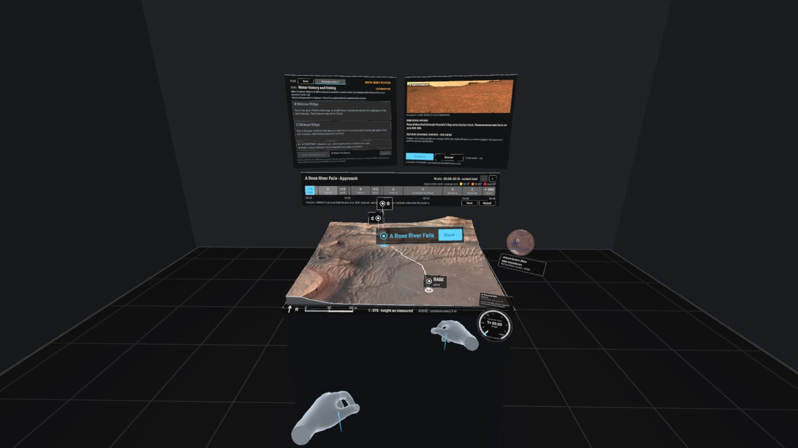
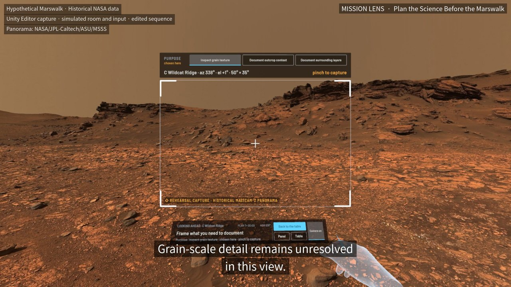
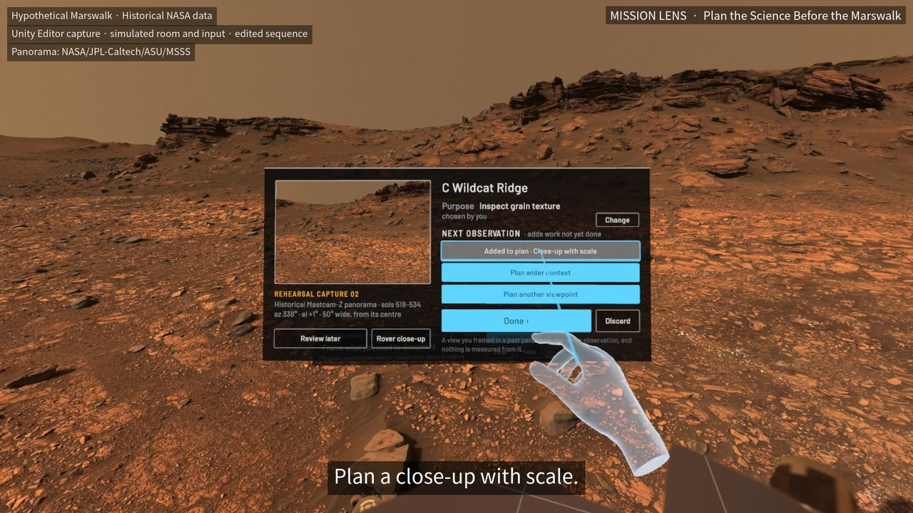
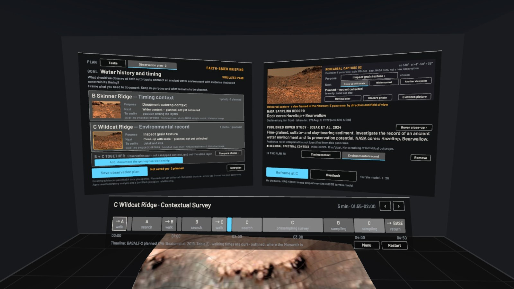
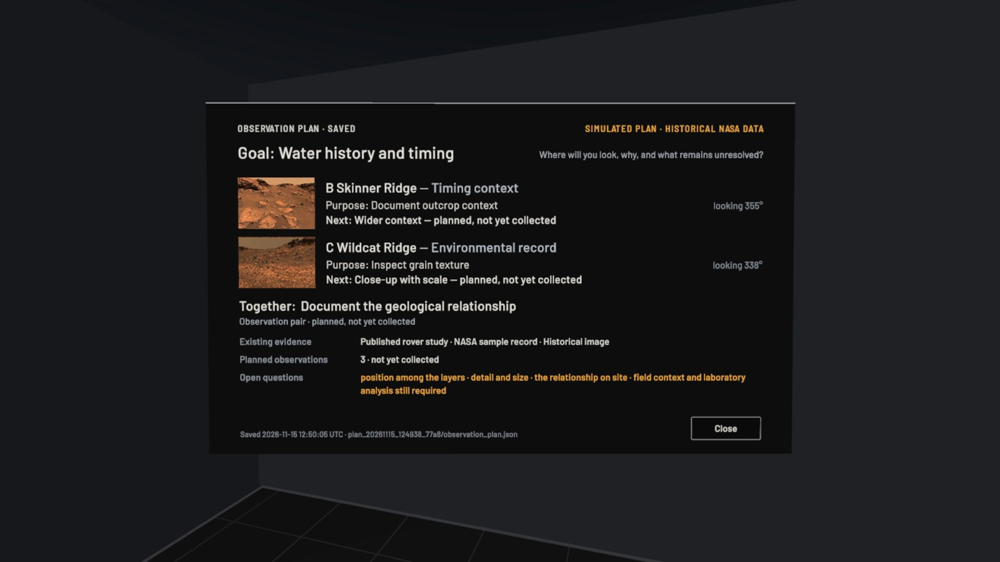
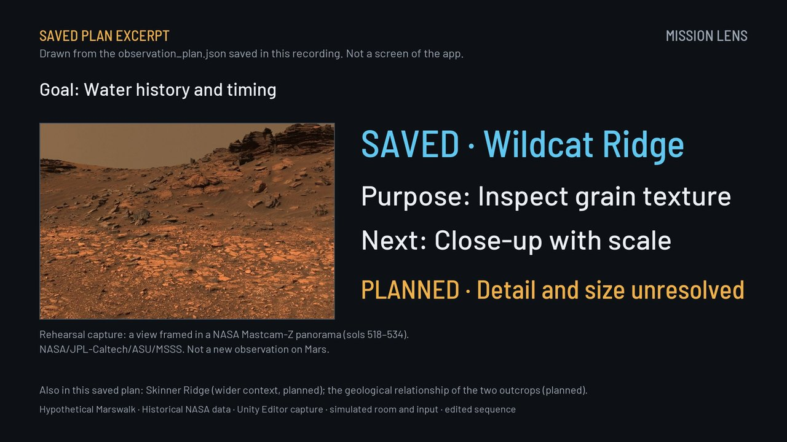

# Using Mission Lens

[Back to the project](../README.md) · [Read a saved plan](examples/observation_plan/README.md)

## Run it

**Meta Quest 3.** Download [MissionLens_Quest3.apk](https://github.com/Ando-O7/MissionLens/releases/download/submission-2026-11-15/MissionLens_Quest3.apk) from the release and install it with `adb install -r MissionLens_Quest3.apk`. Package `com.missionlens.eva01`. Point with a hand and pinch, touch a hand-held panel with a fingertip, or use controllers. Open the left thumb, back of the hand toward you, for the menu.

**Desktop.** Unity 6000.3.6f1. Open `unity/`, make the scene once (`MLBuild.CreateScene`, see [docs/HANDOFF.md](HANDOFF.md) §10) and press Play. Drag to look round, click to select, Enter to begin, Space for the panel in FIELD.

A short walk through the plan: *Begin briefing* → on the timeline choose **B · survey** → on the right panel **Timing context** → choose **C · search** → **Environmental record** → **Stand at C** → **Camera** → click to capture → **Plan close-up with scale** → **Done** → **Table** → on the left panel **Add: document the geological relationship** → **Save observation plan**. The Marswalk itself starts from the left panel's other face, **Tasks**.

## What you do

1. **PLAN — the goal and the two outcrops.** The briefing opens on the observation plan, which is empty. At the table, choose a task at an outcrop (or pick the outcrop on the map). The panel on the right shows NASA's sampling record and a short science card from the published rover study. Give the outcrop the role it serves in the plan: *Timing context* or *Environmental record*. Either role can be given to either outcrop; the app does not hold a right answer.
2. **FIELD — frame a view.** Stand at the outcrop, inside the Mastcam-Z panorama taken there, and open the camera. A frame follows your head. The view takes its purpose from the task you selected (*Document outcrop context*, *Inspect grain texture*, *Document surrounding layers*); if that task carries none, you choose one once, under the frame. Pinch, pull the trigger or click to capture.
3. **Choose the next observation.** The photo's card offers three buttons: *Plan close-up with scale*, *Plan wider context*, *Plan another viewpoint*. Each adds an observation that is still to be made, tied to that photo. None is required, the same one cannot be added twice, and *Review later* only sets the photo aside.
4. **PLAN — both outcrops side by side.** Back at the table the outcrop you stood at is still selected and the photo you just took is open on the right, where its purpose and next observations can be changed or taken back. The plan has one row per outcrop: its role, how many photos and planned observations, and for the photo shown, its purpose, what was planned from it and what that leaves to verify. Picking an outcrop brings up its record; *Compare photos* puts the two outcrops' photos side by side. On the map only the photo that is picked shows as a sector from where it was taken (both, while comparing), and you can return to the panorama facing the same way. However many photos there are, the plan stays three rows.
5. **Add the relationship and save.** *Document the geological relationship* is an item of its own; the line it draws between the outcrops is labelled *Observation pair*, not a contact or a shared layer. *Save observation plan* writes the plan and its images, and says it is saved only after reading the file back.

| | | |
|---|---|---|
|  |  |  |
| PLAN: the model on its plinth, the plan and the evidence | FIELD at Wildcat Ridge: a view framed in the panorama (a frame of the film, with its subtitle) | The photo, its purpose and the next observation |
|  |  |  |
| PLAN again: the photo that was taken is open beside the plan | The saved plan, in the app | The last card of the film: an excerpt drawn from the saved file, not a screen of the app |

The rest of the app, built for the Tokyo venue, is the panel's other face (*Tasks*): a 13-task Marswalk on the timeline, slope and spectral layers on the map, walks between stations with a route check, and regions pointed at in a panorama.

## Three kinds of thing, kept apart

| On screen | What it is |
|---|---|
| **Existing evidence** | Past NASA data you opened in this session: the published rover study, the sampling record, the panorama, an existing rover close-up. A source you did not open is never listed. |
| **Rehearsal capture** | A view you framed in a past Mastcam-Z panorama. It is cut from the image by direction and field of view, from the place the image was taken. It is not a new observation and nothing is measured from it. |
| **Planned observation** | Something still to be done on Mars. Its status is always *planned — not yet collected*; framing a view, opening a rover close-up or saving the plan never changes that. |

Every panel also says where its content comes from, with a mark and a word: ■ **NASA observation**, □ **our calculation**, ◇ **simulated or hypothetical**. Cyan is kept for what can be chosen.

The purposes and next observations are your button choices, shown back in the same words. The app adds no finding of its own: no age, no mineral, no grain size is read from a photo. Ages need laboratory analysis and a justified geological relationship; they are not taken from height or from these images.
