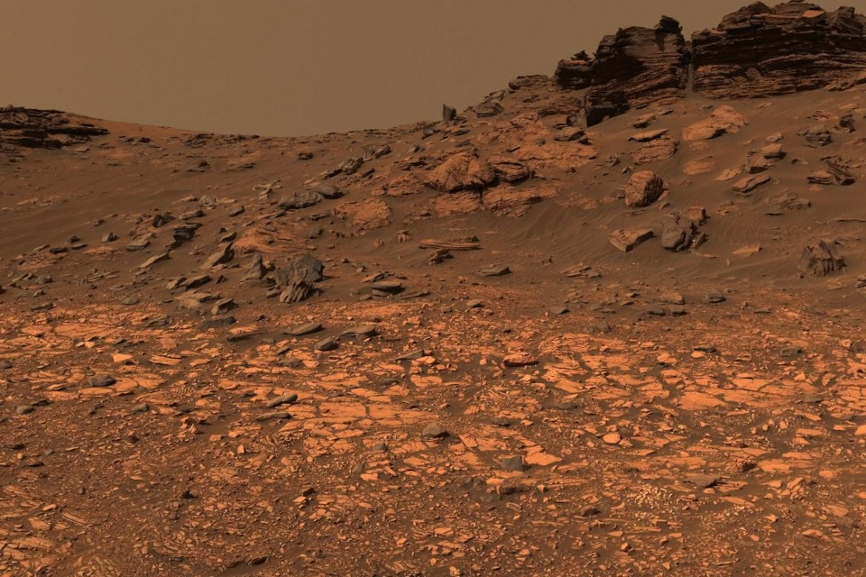

# A saved observation plan

[Back to Mission Lens](../../../README.md) · [Open the saved JSON](observation_plan.json)

This is the plan saved during the recording used for the 29.23-second demo. It was created in the Unity Editor with scripted head and hand input for a **hypothetical Earth-based briefing**. Its photos are views framed in historical NASA panoramas; every follow-up observation below is **planned, not yet collected**.

## Wildcat Ridge: from a view to a next observation

**Goal:** connect an ancient water environment with evidence relevant to its timing.

| Part of the plan | What was saved |
|---|---|
| Location and role | C · Wildcat Ridge — environmental record |
| Purpose | Inspect grain texture |
| Open question | Detail and size at close-up scale remain unresolved |
| Next observation | Close-up with scale |
| Status | Planned |

*A view framed in the Mastcam-Z panorama, sols 518–534. Credit: NASA/JPL-Caltech/ASU/MSSS. This image is the rehearsal capture, not the close-up being planned.*

The purpose is the user's selection. The panorama does not establish the close-up detail and size, so the user adds a close-up with scale to the plan. Saving preserves the connection between this image, that purpose, the next observation and what remains unresolved. Nothing in the image was identified or measured by the app.

The JSON makes that connection inspectable: `captures[id=capture_02]` identifies the image and purpose; `planItems[id=close_up_with_scale_from_capture_02]` refers back to it through `originCaptureId`. Its `status` is `planned`, and its `unresolvedIds` includes `detail_and_size_at_closeup_scale`.

## The complete plan

| Location | Role / purpose | Planned observation | Still to establish |
|---|---|---|---|
| **Skinner Ridge (B)** | Timing context; document outcrop context | Wider context image, linked to [capture 01](capture_01.jpg) | Position relative to surrounding layers |
| **Wildcat Ridge (C)** | Environmental record; inspect grain texture | Close-up with scale, linked to [capture 02](capture_02.jpg) | Detail and size at close-up scale |
| **B and C together** | Document the geological relationship | Document how the outcrops relate | The geological relationship on site; laboratory analysis for timing |

The demo focuses on Wildcat Ridge and omits the Skinner Ridge capture sequence. Both photos and the relationship item are retained in the saved plan. [How the recording was edited](../../DEMONSTRATION.md).

The outcrop roles are planning choices informed by published rover science. The record does not assign a numerical age or assert that these outcrops share a layer. [Scientific references and NASA sources](../../DATA_SOURCES.md).

## Evidence and provenance

For each outcrop, this session opened the published rover science card, NASA sampling record and Mastcam-Z panorama. Their identifiers are recorded in `viewedEvidenceIds` and the relevant plan items' `sourceIds`. An existing WATSON close-up was not opened in this session and is not listed as viewed evidence.

- **Session:** `plan_20261115_124938_77a8`.
- **Saved:** 2026-11-15 at 12:50:05 UTC.
- **Runtime:** Unity Editor 6000.3.6f1 on macOS, with scripted head and hands; not a device build or a human evaluation.
- **Source views:** Skinner Ridge, sols 484–492; Wildcat Ridge, sols 518–534. Each capture also retains its source panorama, direction, field of view and projection.
- **Mission input hash:** `md5:b34138f145367d6bf8a6c83465b0c28e`, as recorded by the app.

[observation_plan.json](observation_plan.json) and the two JPEGs are copies of the files in the [demo recording's plan folder](../../../demo/MissionLens_briefing_30s_en_focus_plan/). This page explains that saved output; it reports no measured improvement in planning or training.

[Record format and model assumptions](../../TECHNICAL_REFERENCE.md#the-saved-plan) · [Evidence audit and its scope](../../validation/README.md)
