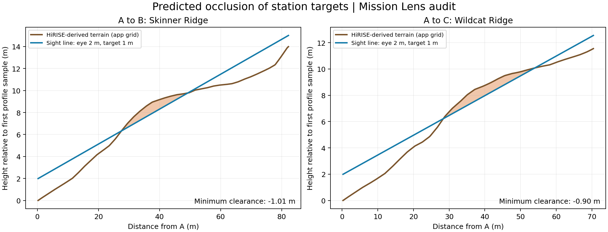
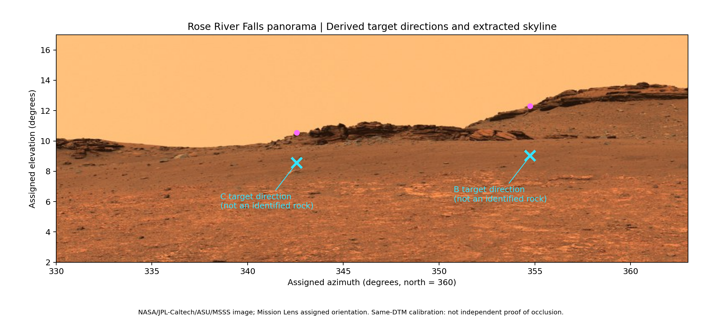

# Mission Lens: evidence audit and proposed user evaluation

Date: 2026-11-15. Status: **computational checks completed; human evaluation not conducted**. No Unity application changes were made by this audit. Proposed product features and proposed study outcomes are not completed results.

This folder evaluates the working tree in `MissionLens/`, not the separate `mission-lens-codex/` prototype. The reference HEAD was `9b7f712`, with uncommitted application changes. Input hashes in `geometry_results.json` identify the audited data and processing files more precisely than that commit alone. An APK was not executed on a Quest during this audit.

## Claim under evaluation

A briefing can make a science objective concrete by connecting it to chosen views, observation locations, planned actions and unresolved questions. Retaining the initial observation types is compatible with this claim: changing the plan is not the goal or a required outcome. The first proposed check concerns whether the user and a recipient can read those connections from the saved briefing. A later study can compare Quest with a desktop interface offering the same information.

The completed checks establish data and model consistency. They do **not** establish better human decisions, astronaut training effectiveness, real-world learning transfer, safe traversability, or operational suitability on Mars.

## Reproduction

From the parent workspace containing both `MissionLens/` and `reports/`:

```sh
MissionLens/.venv/bin/python reports/mission_lens_validation/check_geometry.py
MissionLens/.venv/bin/python reports/mission_lens_validation/check_panorama.py
MissionLens/.venv/bin/python reports/mission_lens_validation/check_source_grid.py
MissionLens/.venv/bin/python reports/mission_lens_validation/check_sample_records.py
```

The first two commands use the repository's cached inputs. They require NumPy, Pillow and OpenCV; panorama reproduction imports the repository's existing `build_official_pano.py`. The third requires rasterio/GDAL and network access to read a window of the public USGS GeoTIFF. The fourth reads the public NASA sample layer; it also accepts an already downloaded JSON path as its only argument. Neither command modifies application assets. HTTP timeouts are bounded, but availability of external servers can affect reproduction.

To regenerate the figures, use an environment with NumPy, Pillow and Matplotlib:

```sh
python reports/mission_lens_validation/plot_checks.py
```

The audit used isolated temporary plotting dependencies. No application package requirements were changed. The checked-in results permit inspection without those dependencies. For a separately published copy, include or document the required `MissionLens/` input paths; this folder alone does not contain the terrain and image assets.

## Completed result 1: source terrain and modeled visibility

Source: [USGS Mars 2020 HiRISE-derived DTM mosaic](https://planetarymaps.usgs.gov/mosaic/mars2020_trn/HiRISE/JEZ_hirise_soc_006_DTM_MOLAtopography_DeltaGeoid_1m_Eqc_latTs0_lon0_blend40.tif).

- Read the public source window at offset (10021, 12110), size 1363 × 1185. Source CRS reported by GDAL: ESRI:103885; source raster spacing: 1 m in its projected coordinates.
- The source window matches the local 1 m cache exactly: maximum absolute elevation difference 0 m.
- The runtime binary equals the cache sampled with `[::2, ::2]`: 682 × 593 samples. The app's local ground-scale intervals are approximately 1.899 m east–west and 2.002 m north–south.
- Reimplemented the current line-of-sight algorithm and reproduced all 12 directed station visibility flags.
- Current algorithm: eye 2 m above station terrain, target 1 m above the other station's terrain; terrain exceeding the ray by more than 0.3 m triggers an occlusion flag. It samples at approximately 1.5 m and omits some endpoint samples.

| Direction | Range | Azimuth, clockwise from north | Minimum clearance, current algorithm | Minimum clearance, fresh 1 m source using its true transform |
|---|---:|---:|---:|---:|
| A → B | 82.47 m | 354.76° | −0.990 m | −1.135 m |
| A → C | 70.68 m | 342.57° | −0.877 m | −0.946 m |

Negative clearance means terrain is above the ray. The fresh-source calculation samples every approximately 0.25 m along the line; this sampling density does not increase the terrain's native resolution. Both calculations predict occlusion of the specified **station target points**. They do not prove that entire outcrops are invisible.

The app currently maps nominal AOI extents onto raster sample indices. Comparing this mapping with true source pixel centers revealed offsets of roughly 1 m near the relevant stations. The fresh-source result shows that correcting this mapping does not reverse these two default predictions. A production correction should keep all map layers and coordinates consistent.



The figure uses dense sampling of the app grid and terrain-derived endpoint heights. Its minimum clearances therefore differ slightly from the stored-height, coarser original algorithm in the table. Both methods and numbers are retained, rather than rounding them into a single apparent measurement.

Files: [geometry results](geometry_results.json), [dense profiles](los_profiles.json), [fresh-source check](source_grid_results.json), [SVG figure](los_profiles.svg).

## Completed result 2: sensitivity, not confidence intervals

Tested two targets, four eye heights (1.5, 1.7, 2.0, 2.2 m), three target heights (0, 1, 2 m), and two grids (runtime grid and 1 m cache mapped to the same nominal extent): 48 combinations. Forty-six exceeded the 0.3 m occlusion threshold. The two exceptions concern C with eye and target both high; their minimum clearance is still negative but within the algorithm's 0.3 m tolerance.

For each target, independently displaced both endpoints by −2, 0, or +2 m along each horizontal axis: 81 combinations per target. With eye 2 m and target 1 m, all predicted occlusion. Minimum clearance ranges: B −1.355 to −0.726 m; C −1.071 to −0.657 m.

These are hypothetical perturbations, not calibrated error distributions. **46/48 is not a 96% confidence level.** The checks do not encompass independently measured vertical error, sub-grid rocks, uncertain target geometry, or all image/terrain registration errors.

## Completed result 3: panorama registration consistency

Source image: [Mastcam-Z Rose River Falls, sol 454](https://mcz-images.sese.asu.edu/Mastcam-Z_360_Rose_River_Falls_Sol454_L0_natural.jpg), credit NASA/JPL-Caltech/ASU/MSSS. App output: 8192 × 2209 pixels, derived from the 30000 × 8091 source mosaic. Camera orientation was assigned by Mission Lens, not supplied as an independently verified orientation of the JPEG.

Re-ran the feature registration against the sol 449 Navcam reconstruction, then the same terrain-skyline fitting used by the project:

- Feature stage: 356 matches, 39 inliers; uneven angular coverage. Initial source-column-zero azimuth approximately 43.830°.
- Skyline fitting changed azimuth by approximately 3.779°. Final source-column-zero azimuth 40.051°, image top elevation 18.862°; these reproduce the stored values to their rounding precision.
- The reported skyline residual MAD of 0.186° is a **fit residual against the same DTM**, not independent absolute orientation accuracy. The stored last-iteration zero correction does not mean no skyline correction was applied.
- B/C target directions fall below locally extracted skyline edges in the registered image. Edge extraction searches a ±4° window around the model prediction. This is a visual/model consistency check, not an independent identification of the outcrops, and a horizon feature may lie beyond a target.



Cyan crosses are assigned target directions, not identified rocks; magenta dots are extracted image edges. Image orientation, endpoint positions and the skyline comparison share model assumptions. No photogrammetric depth or exact sample-site localization is established.

File: [panorama results](panorama_results.json).

## Completed result 4: CRISM spatial support and sample records

Source browse product: [FRT00005C5E_07_BRPHYJ_MTR3](https://pds-geosciences.wustl.edu/mro/mro-m-crism-5-rdr-mptargeted-v1/mrocr_4001/browse/2007/2007_139/frt00005c5e/frt00005c5e_07_brphyj_mtr3.png). The project uses its red D2300 browse channel, averaged over 3 × 3 displayed pixels, to calculate station percentiles. This is not a mineral abundance or identification measurement.

B and C are 20.05 m apart. At nominal 18 m/pixel, their 3 × 3 windows share 6 of 9 pixels. The project also applies a constant image translation of approximately 285 m, with residual registration error not evaluated. The displayed 81 versus 77 percentiles do not support a robust ranking of these two outcrops. Use CRISM for regional context, and rover geology for the B/C distinction.

The [NASA sample map layer](https://mars.nasa.gov/mmgis-maps/M20/Layers/json/M20_SAMPLE_v3.json) was fetched separately and its relevant fields compared with the local extracts. Results and public-file hash are in [sample_records_results.json](sample_records_results.json). A station coordinate and a map's sample-record coordinate are different entities; neither is an independently surveyed location of a new image-selected rock.

## Additional completed check: saved demo plan artifact

On 2026-11-15 at 11:31 UTC, a new Editor demo artifact was inspected: `MissionLens/demo/MissionLens_briefing_30s_en_plan/observation_plan.json`. It contains two rehearsal captures, one photo-linked wider-context observation at B, one photo-linked close-up-with-scale observation at C, and a planned geological-relationship record. Both linked image files exist. Each photo-linked observation refers to an existing capture at the same station with the same purpose; all are marked planned. Saved item IDs are consistent, and the recorded mission JSON hash matches the runtime resource read during this check. The corresponding saved-card screenshot displays these roles, purposes and planned observations.

Results, artifact hash and scope: [saved-plan artifact check](saved_plan_artifact_20261115.json). This is inspection of an exported example and its screenshot, not an independently executed application test. Restart persistence, Quest operation, semantic correctness of selected image targets, and human benefits were not tested by this check. It does not revalidate changed source inputs against the earlier terrain and panorama audits. No Unity code was changed by the review.

## Proposed human evaluation — not conducted

### First check: can the briefing be understood and handed over?

Using one guided case, ask the user to identify a planned location, the corresponding image, its purpose and what remains unresolved. Then ask a second person, who did not watch the session and has access to the saved briefing and its linked evidence, to identify the same elements. Record time, missing links, misinterpretations and whether either person mistakes a planned observation for an acquired result. Include a case where the original observation types are retained and a case where observations are added or deferred; these are coverage checks, not required participant behaviors. An inherited label alone does not establish understanding. This is a proposed usability check, not a completed validation of training effectiveness or field transfer.

### Subsequent comparison: Quest and desktop

**Primary question:** with identical information, can the Quest interface help users create a science plan that correctly connects the objective, observational limits, and the next action?

For a small formative test, recruit 8 participants and randomly allocate 4 to PC and 4 to Quest, balancing prior map/XR familiarity as far as practical. Use the same one-off Jezero case in both groups to avoid cross-condition memory contamination. This sample is too small to establish general superiority; participants also do not represent trained astronaut crews.

Both conditions receive the same terrain, resolution, stations, panoramas, image orientation, science cards, sources, visibility assumptions, task wording, final decision fields and time limit. The PC condition must offer map rotation, panorama look-around, synchronized station selection, and the same evidence cards; it must not be reduced to a static map. Quest adds head/body rotation and its normal selection method, not extra information. Fix panorama camera centers for both. Use identical non-task practice before the test.

Task (updated after the developer selected the paired-outcrop planning direction): plan observations at Skinner Ridge and Wildcat Ridge that connect an ancient water environment with evidence relevant to its timing. Review identical historical evidence in both conditions, frame and save panorama views, specify required close-ups and documentation of the geological relationship, and submit reasons and uncertainties. Both conditions must offer the same camera framing, archived close-up references and plan fields. No fictional ten-minute allocation or forced initial error is required. No feedback on correctness until completion.

The selected product interaction inherits the observation purpose from the selected task and offers the same next-observation buttons in both conditions: close-up with scale, wider context, and another viewpoint. Each selection creates a pending observation linked to the photograph; a separate review flag only marks a deferred decision. Voice recording and keyboard entry are not required. Log actual task and action selections separately from inherited labels. A correct automatically populated label is not evidence of participant understanding; interpret the plan rubric as output quality and use a brief, identical post-task explanation prompt in both conditions to probe why the participant chose an observation and what the current image cannot establish. These proposed measures have not been collected.

**Primary outcome:** independently grade the final saved plan using the following prespecified 0–4 rubric, with one point for each:

1. The observations at both sites have coherent, source-supported connections to the environmental-record and timing-context objective; these are complementary roles, not exclusive properties of each rock.
2. The plan distinguishes context images from texture close-ups requiring appropriate scale/resolution; a panorama crop is not treated as newly resolved grain evidence.
3. The plan includes documentation of the geological relationship rather than inferring age from terrain elevation alone.
4. The rationale distinguishes historical evidence, rehearsal captures and planned observations, and leaves numerical dating to laboratory analysis with appropriate geological context. It does not assert confirmed life/organics or precise new sample locations without evidence.

Have a geoscience-informed reviewer inspect the rubric before recruitment; if unavailable, report the grading as developer-defined. Prefer two graders of de-identified records, unaware of condition. Record disagreements rather than silently resolving them in the product's favor.

Secondary measures: completion time including interface overhead, unsupported claims, evidence cards visited, incomplete attempts, discomfort/dropout, and a brief workload rating. Initial-to-final changes can be recorded descriptively, but more changes do not imply a better plan; retaining well-supported observations is not a failure. Optional angular pointing error is relative to the **assigned model bearing**, not verified field navigation accuracy. Disable auto-facing of the target and guidance lines for that optional measurement; currently `CoToField` can reset orientation and confound it.

Report every participant's score/time, group medians and ranges, failures and qualitative explanations. Do not present a small exploratory difference as proof of training transfer, safety, or astronaut performance. A larger future study would need expert participants, multiple matched cases, independent geometry checks and a real-environment transfer task.

Predefined interpretation: if both interfaces produce equivalent good plans, report that participants in this small case could complete the workflow and treat XR's incremental benefit as unresolved. If Quest adds delay or errors, improve the interface or emphasize the desktop-accessible decision workflow. A pleasant experience alone is insufficient evidence of better planning. None of these study procedures has yet been conducted; the completed numerical audits above are unchanged by this protocol revision.

## Provenance and disclosure

Terrain, rover imagery, spectral browse data and sample records originate from the credited public sources. Scripts, numerical audits, figures and explanatory writing in this folder were prepared with AI assistance in Codex and reviewed against the repository inputs. Figures are computed plots and annotations of NASA imagery, not generated Martian observations. No human-subject results have been generated or simulated.
